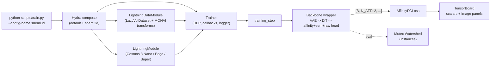

# nanocosmos

A PyTorch Lightning infrastructure for **spatially-coloured (nanocosmos-style)
instance segmentation** of 3-D connectomics volumes, built on NVIDIA's
Cosmos 3 video-diffusion backbones (DiT + Wan2.2 VAE). The shipped tiers
are Nano (16B), Edge (4B), and Super (64B).

> **Datasets.** [`doc/DATASETS.md`](doc/DATASETS.md) is the catalog
> (what each volume is, resolution, download script).
> [`doc/RESOLUTION_LADDER.md`](doc/RESOLUTION_LADDER.md) places those
> volumes on the voxel-size ladder and assigns SSL / SFT roles.
> Per-subset counts live in [`doc/data.csv`](doc/data.csv).

## Architecture at a glance



Three Cosmos 3 backbones live under `nanocosmos/models/`:

- **`Cosmos3Nano3DWrapper`** — Cosmos 3 Nano (16B) omni transformer; the
  shipped default backbone for the `snemi3d` recipe.
- **`Cosmos3EdgeWrapper`** — Cosmos 3 Edge (4B); loads
  `nvidia/Cosmos3-Edge` (`configs/nanocosmos-4B.yaml`).
- **`Cosmos3SuperWrapper`** — Cosmos 3 Super (64B).

All emit the same affinity + sem + raw head. The channel layout lives in
`nanocosmos/losses/_common.py`. At eval, predicted affinities are
agglomerated by `nanocosmos.inference.mutex_watershed`.

## What it does

Every backbone trains one **affinity + sem + raw per-voxel head**
(`HEAD_CHANNELS = N_AFF + 2`).  The head width is config-driven: it is
derived at runtime from the loss offset set (`head_channels =
len(loss_offsets) + 2`; see `nanocosmos/modules/base.py`).  The default
`snemi3d` layout uses `N_AFF = 14` offsets, so `HEAD_CHANNELS = 16`; the
flagship recipes (`nanocosmos-4B` / `nanocosmos-16B` and the standalone
`cosmos3nano3d`) declare 30 offsets, so
`HEAD_CHANNELS = 32`:

| channels | field | meaning |
|---:|---|---|
| 0 .. N_AFF-1 | `aff` | per-offset affinity logit for `P(label[v] == label[v+offset])` |
| N_AFF (1) | `sem` | foreground / boundary logit |
| N_AFF+1 (1) | `raw` | input-EM reconstruction (linear, L1; target in `[-1, 1]` with `vae_input_pm1`) |

The head emits **raw logits / linear values** (no activation in `forward`);
`sigmoid` is applied only at the loss, metrics, Mutex Watershed, and
TensorBoard boundaries.

The default affinity offsets (`nanocosmos.losses.AFFINITY_OFFSETS`) are
3 **pull** nearest-neighbours plus 11 **push** long-range offsets
(anisotropy-aware for EM); the flagship recipes override this with a
30-offset set (5 pull + 25 push).  `AffinityFGLoss` supervises the
affinities (masked BCE + soft-Dice + focal) directly against the binary
label-derived target; at evaluation / inference the predicted
affinities are agglomerated into instances by the **parameter-free
Mutex Watershed** (`nanocosmos.inference.mutex_watershed`, GPU or CPU).

## Layout

Skim of the top level:

```
nanoCosmos/             repo root
├── configs/             Hydra configs (default → snemi3d → combine;
│                         nanocosmos-16B / nanocosmos-4B
│                         = joint SR+seg; nanocosmos-4B-pretrain = raw-EM SSL)
├── nanocosmos/          importable package (losses, models, modules,
│                        datasets, datamodules, transforms, inference,
│                        preprocessors, metrics, visualizer, callbacks)
├── doc/                 DATASETS / RESOLUTION_LADDER / data.csv
│                        / dataset preview PNGs
├── scripts/             train.py entry point + dataset downloaders
├── tests/               pytest suite
├── pyproject.toml
└── requirements.txt     pinned lockfile (see top-of-file for usage)
```

## Install

From the repo root. `requirements.txt` pins the stack (Python 3.13, CUDA 13.4, torch 2.16.0.dev20261027+cu134). `pip install -e . --no-deps` installs this package on that lockfile.

```bash
pip install -r requirements.txt
pip install -e . --no-deps
```

## Train

Run from the repo root.

```bash
# Plain SNEMI3D run:
python scripts/train.py --config-name snemi3d

# Multi-dataset (SNEMI3D + neurons + MICrONS) affinity training:
python scripts/train.py --config-name combine

# DDP, custom batch size:
python scripts/train.py --config-name combine data.batch_size=4 training.devices=4

# Example: train affinities only (drop the sem + raw aux heads).
python scripts/train.py --config-name combine loss.weight_sem.weight=0.0 loss.weight_raw.weight=0.0

# Joint super-resolution + segmentation (resolution-ladder recipe):
#   ssl (degraded->clean EM reconstruction) + sft (affinity + sem) on a
#   shared backbone via Joint3DReconSegLoss.
python scripts/train.py --config-name nanocosmos-16B   # Cosmos 3 Nano
python scripts/train.py --config-name nanocosmos-4B    # Cosmos 3 Edge (released checkpoint)
python scripts/train.py --config-name cosmos3nano3d    # flattened Nano recipe

# Edge pretrain on multiscale raw EM only (SSL, no segmentation):
python scripts/train.py --config-name nanocosmos-4B-pretrain
```

### GPU memory: avoiding slow OOM drift on long runs

On long DDP runs (especially with `compile: max-autotune`) the
PyTorch caching allocator's reserved pool tends to creep upward over
hours even though live tensors are stable.
Two settings make the difference between "stable at 90 %" and "OOM at
epoch 30":

```bash
# 1.  Enable expandable allocator segments BEFORE launching python.
#     Mitigates fragmentation; near-zero runtime cost.  Read at CUDA
#     init, so it must be exported (cannot be applied in-process).
export PYTORCH_CUDA_ALLOC_CONF=expandable_segments:True

# 2.  Empty the cache around validation (callback already on by
#     default in snemi3d.yaml; turn on for custom configs):
#         callbacks.cuda_empty_cache_before_val: true
#     This empties on BOTH sides of validation so the val-time
#     high-water mark does not stay reserved in the training pool.

python scripts/train.py --config-name snemi3d
```

Watch the trajectory in TensorBoard under the `cuda_memory/*` tags
(emitted by `CudaMemoryLoggerCallback`, on by default):

| Pattern                                                | Diagnosis                                                     |
|--------------------------------------------------------|---------------------------------------------------------------|
| `allocated_gb` flat, `reserved_gb` rising              | fragmentation — set `PYTORCH_CUDA_ALLOC_CONF` as above.       |
| `allocated_gb` and `reserved_gb` both rising           | tensor leak — inspect callbacks (image_logger, custom hooks). |
| sawtooth coupled to val epochs                         | val peak polluting train pool — enable the callback above.    |

## Loss

```python
from nanocosmos.losses import AffinityFGLoss, HEAD_CHANNELS, slice_head

loss_fn = AffinityFGLoss()
# head:      [B, 16, D, H, W]   (HEAD_CHANNELS)
# labels:    [B, D, H, W]
# raw_image: [B, 1, D, H, W]
out = loss_fn(head, {"labels": labels, "raw_image": raw_image})
# out -> {"loss", "loss/aff", "loss/sem", "loss/raw"}
fields = slice_head(head)  # {"aff", "sem", "raw"} views
```

## Tests

```bash
pytest tests/ -q
```

## License

MIT.  See `LICENSE`.
